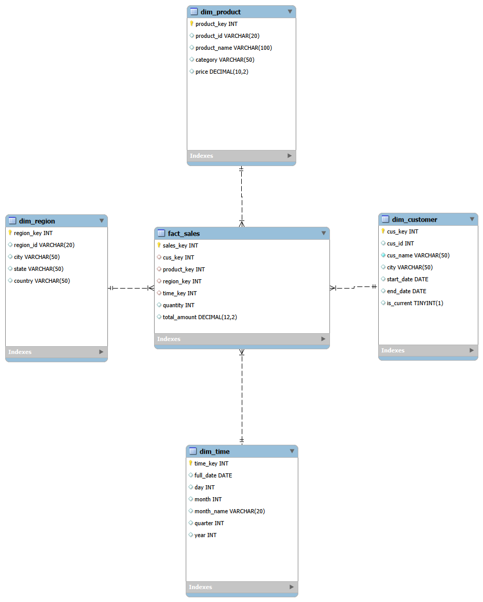

# E-Commerce Data Warehouse – Star Schema

## Project Overview
This project demonstrates the design and implementation of an E-Commerce Data Warehouse using MySQL and SQL.

The objective is to organize sales data into a Star Schema for structured reporting and analysis.

## Technologies Used
- MySQL
- SQL
- MySQL Workbench

## Database Design

The warehouse contains five tables:
## Star Schema Diagram

**Dimension Tables**
- dim_customer
- dim_product
- dim_region
- dim_time

**Fact Table**
- fact_sales

## Key Implementations
- Designed Star Schema architecture.
- Created Fact and Dimension tables.
- Established relationships using Primary Keys and Foreign Keys.
- Implemented SCD Type 2 to maintain customer history.
- Practiced SQL JOINs and aggregate functions.
- Prepared SQL queries for sales reporting.

## Reporting
The warehouse supports reporting such as:
- Total sales
- Product-wise sales
- City-wise sales
- Customer-wise sales
- Monthly sales

## Learning Outcomes
- Understanding of dimensional modelling.
- Practical SQL and data warehousing experience.
- Understanding of historical data management using SCD Type 2.
